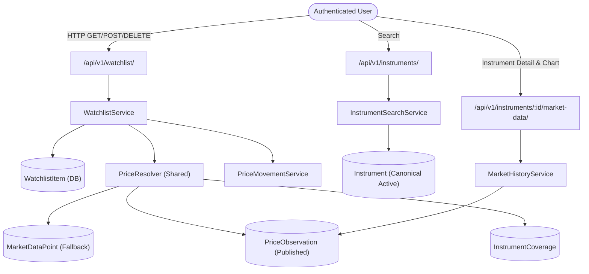

# Sprint 5 — Watchlist and Manual Market-Data Integration: Repository Audit & Correction Matrix

**Document Version:** 1.0.0  
**Phase:** Sprint 5 Pre-Implementation Audit  
**Date:** 2026-11-17  
**Branch:** `sprint-5`

---

## 1. Repository Audit Findings

### 1.1 Backend Architecture
- **Canonical Instruments (`apps.market_data.models.instrument`)**:
  - The `Instrument` model exists, uses UUID primary keys, and supports `AssetClass` (EQUITY, MUTUAL_FUND, COMMODITY, FIXED_INCOME, REAL_ESTATE, CRYPTO, INDEX, CASH_EQUIVALENT).
  - Identifiers: `symbol`, `name`, `isin`, `scheme_code`, `exchange`, `status`, `is_active`.
  - `InstrumentReferenceData` stores sector, industry, and metadata.
  - Bidirectional status synchronization: `save()` keeps `is_active` and `status` consistent.
- **Manual Market-Price System (`apps.market_data`)**:
  - Models: `PriceObservation` (DRAFT, PENDING_REVIEW, PUBLISHED, REJECTED), `InstrumentCoverage`, `MarketDataWorklist`, `PriceImportBatch`.
  - Service: `PriceResolver` authoritatively resolves latest prices, enforcing publication status, staleness against coverage policy, and distinguishing `AVAILABLE`, `STALE`, `MISSING`, `SYNTHETIC`, and `UNSUPPORTED`.
- **Existing Watchlists App (`apps.watchlists`)**:
  - `apps.watchlists` exists in `INSTALLED_APPS` with `apps.py`, but has no models, serializers, views, or endpoints.
- **Valuation & Investment Domain (`apps.assets`, `apps.valuation`)**:
  - Investments and valuation snapshots exist with complete user isolation and transaction integrity.
  - Watchlist operations must never modify investment records, transactions, or valuation history.

### 1.2 Frontend Architecture
- **Shell & Navigation**:
  - `AuthenticatedLayout.tsx` already features a top-level `Watchlist` navigation link pointing to `/watchlist`.
  - `router.tsx` currently routes `/watchlist` to a temporary `WatchlistPlaceholderPage.tsx`.
- **Existing Components**:
  - `InstrumentSearch.tsx` in `features/market-data/components/` provides debounced autocomplete, keyboard navigation, and unlisted instrument request modal integration.
  - Theme system supports both dark and light themes through CSS variable tokens.
- **TanStack Query & API Client**:
  - `apiClient` provides standard typed HTTP calls with JWT refresh handling.

---

## 2. Requirement-to-Code Correction Matrix

| Requirement Area | Existing Repository State | Identified Gap | Planned Resolution |
|---|---|---|---|
| **3.1 WatchlistItem Model** | Empty `apps.watchlists` app. | Missing database model, relationships, and uniqueness constraints. | Implement `WatchlistItem` with UUID, FK to `User`, FK to `Instrument`, `notes`, `target_price`, unique constraint on `(user, instrument)`, and indexes. |
| **3.1 Isolation & Integrity** | N/A | Deletion cascade could mistakenly touch instrument or investments if misconfigured. | Configure `on_delete=models.CASCADE` on `WatchlistItem` foreign keys, ensuring instrument deletion rules and investment records remain completely independent. |
| **3.2 Instrument Search** | Generic `search` action in `InstrumentViewSet`. | Search only queries symbol/name/isin; does not filter out inactive/unapproved or support comprehensive fields. | Implement `InstrumentSearchService` supporting symbol, name, ISIN, scheme code, exchange, product type, sector/industry, strictly returning active canonical instruments. |
| **3.3 Watchlist Overview** | Placeholder page only. | No API or UI to fetch user's watchlist items with latest resolved price and movement. | Implement `WatchlistService.list_items()` annotating items with `PriceResolver` and `PriceMovementService` outputs; create `WatchlistTable` and `WatchlistCard`. |
| **3.4 Price Movement** | Provider quote change percent existed only on synthetic data points. | No backend decimal-safe calculation comparing historical published observations. | Implement `PriceMovementService` calculating `absolute_change = current - previous` and `percentage_change = (absolute_change / previous) * 100` using `Decimal`, returning `UNAVAILABLE` when previous price is 0 or missing. |
| **3.5 Instrument Detail** | Basic `/api/v1/instruments/{id}/` endpoint. | Missing dedicated endpoints for latest market data, status, and historical points. | Add `/api/v1/instruments/{id}/market-data/latest/`, `history/`, and `status/` endpoints; build `InstrumentDetailPage` with interactive chart. |
| **4.1 Shared Price Resolver** | `PriceResolver` implemented in `apps.market_data.services.price_resolver`. | Watchlist needs to consume this exact resolver without duplicate pricing logic. | Directly wire `WatchlistService` to `PriceResolver.resolve_price()` &mdash; zero price truth duplicated in watchlist database. |
| **4.2 Price Freshness** | `InstrumentCoverage` freshness hours implemented. | Watchlist cards must display explicit freshness status badges. | Return `freshness_status` and `provenance` in API response; implement `PriceFreshnessBadge` in UI. |
| **4.4 Historical Price API** | `MarketDataService.get_history` queries `MarketDataPoint`. | Does not prioritize verified `PriceObservation` records or validate future date bounds. | Implement `MarketHistoryService` returning chronologically ordered observations with date-range validation, rejecting future dates, and handling unsupported history gracefully. |
| **6.0 Frontend Features** | `WatchlistPlaceholderPage.tsx`. | No interactive watchlist tables, cards, modal add, detail view, or charts. | Build modular components in `features/watchlists/`: `WatchlistTable`, `WatchlistCard`, `AddToWatchlist`, `PriceMovement`, `PriceFreshnessBadge`, `WatchlistEmptyState`, `InstrumentPriceChart`, `WatchlistPage`, `InstrumentDetailPage`. |
| **7.0 Cache Management** | No watchlist query keys. | Watchlist additions/removals could leave stale cache. | Implement TanStack Query hooks with targeted query key invalidation (`['watchlist']`, `['instrument-latest-price']`, etc.). |
| **9.0 Automated Testing** | 164 backend tests, 121 frontend tests pass. | Zero tests covering watchlist domain, price movement math, or watchlist API contracts. | Implement comprehensive test suite: `test_watchlist_model.py`, `test_watchlist_api.py`, `test_price_movement_service.py`, `test_market_history_service.py`, and frontend tests. |

---

## 3. Architecture Blueprint

